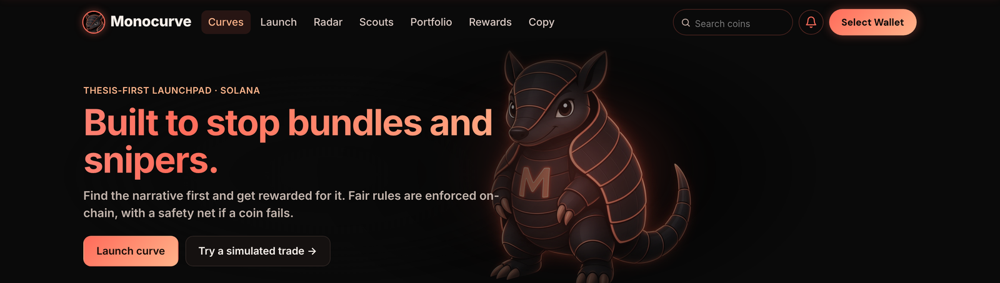
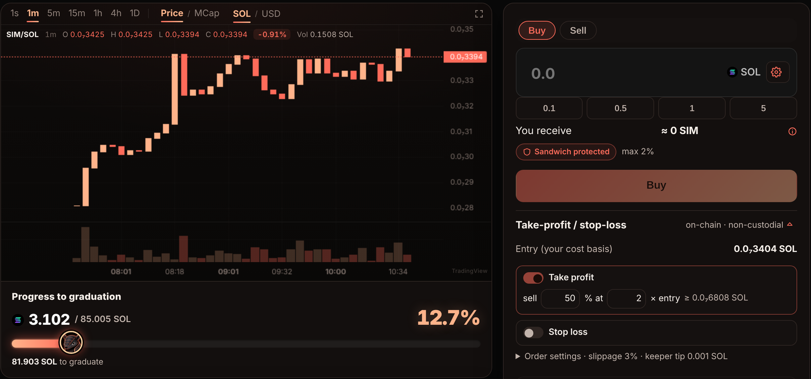
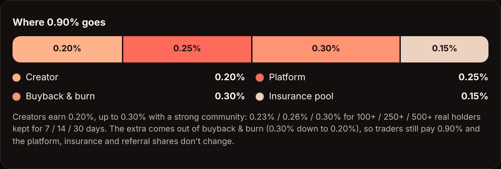
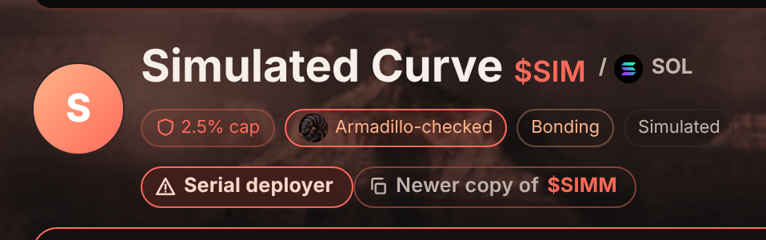
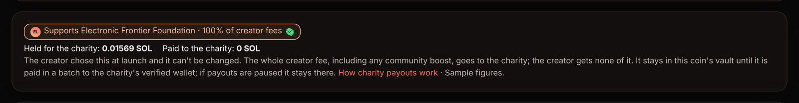
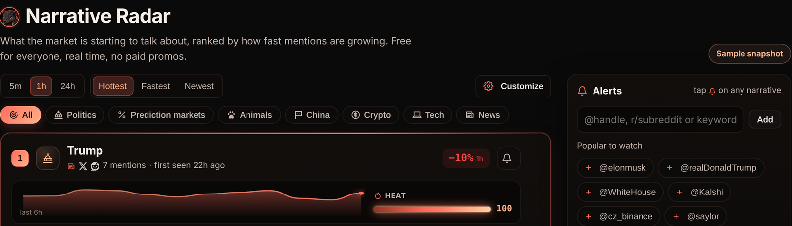
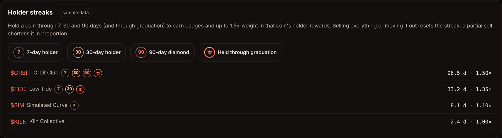

  

<h1 align="center">Monocurve</h1>

<b>The fair-launch bonding curve for Solana.</b> 
One idea per coin. Same terms for everyone. A safety net if it fails.

  
  
  
  
  

> **Status:** Live on Solana **mainnet** since October 16, 2026. Trade and launch at [monocurve.app](https://monocurve.app).
> Everything below describes how the program works today.

---

## Why Monocurve

| | |
|---|---|
| 🎯 **Sniper tax** | Buys right after launch pay a tax that starts at 99% and falls every slot to 0 at 15 minutes. All of it goes to the coin's holders, never to Monocurve or the creator. Sells are never taxed. |
| 🚫 **No dev snipe** | The creator can't buy in the launch transaction or in the first 10 minutes, and any creator buy before 15 minutes pays the same sniper tax as everyone. Creator buys unlock over 24 h. |
| ⚖️ **Fair start** | First 30 s: one buy per wallet or linked group. First 10 min: established wallets only. First 5 min: max 1% of supply per slot. |
| 🧱 **Caps** | Max 2.5% of supply per wallet (buys *and* transfers) while on the curve, and max 40 SOL per buy. Bundling gets costlier, not impossible. |
| 🔤 **One coin per ticker** | Look-alikes (`PEPE2`, `BABYPEPE`, `P3PE`, Cyrillic look-alikes) fold to the same ticker and are refused. |
| 🪙 **Anti-squat launches** | A 0.02 SOL launch deposit, refunded when the coin graduates. Up to 3 of your coins on the curve at once. A failed coin's launcher waits 30 days to reuse its ticker. |
| 🔒 **Creator fees in escrow** | Creator fees are held in the coin until it graduates. If it fails, they go to that coin's holder refunds. |
| ↩️ **7-day refund mode** | Not graduated in 7 days? Holders redeem their cost basis (scaled only if the coin is short), plus **up to 10%** from insurance. |
| 🥪 **Sandwich protection** | Mandatory min-out, short quote deadlines and a same-slot buy/sell guard on every trade. |
| 📉 **On-chain TP / SL** | Take-profit, stop-loss and trailing stops on the curve. Tokens stay in your wallet. |
| 💝 **Charity coins** | 100% of the creator fee goes to a verified charity, with public on-chain payouts. The creator gets none of it. |
| 🔥 **Buyback & burn** | 0.30% of every curve trade buys the coin back and burns it. |
| ✓ **Verified handles only** | The check mark means an X handle was proven with X sign-in plus a wallet signature. Nothing else gets one. |
| 🚩 **Serial-deployer flags** | Wallet clusters that spam launches or copy a narrative get flagged; the first real coin gets the **Original** badge. |
| 📈 **Community fee boost** | Coins that keep real holders for weeks earn the creator up to 0.30%, paid from buyback, never from traders. |
| 🏅 **Holder streaks** | Badges at 7 / 30 / 90 days; up to 1.4× weight in reward-coin payouts, 1.5× if you held through graduation. |
| 📡 **Narrative Radar** | Real-time trending narratives with heat scores, alerts and one-tap launch. Free for everyone. |
| 🎥 **Public profiles** | Calls, coins and verified socials in one place, with live-stream links for creators who stream. |

---

## Trade

Every bonding-curve trade pays **0.90%**, split four ways. After a coin graduates, its permanently locked liquidity earns the DEX pool's 0.90% trading fee, split the same way (platform about 0.25% of volume). Launching takes a 0.02 SOL deposit that comes back if the coin graduates.

→ [Fees](docs/FEES.md) · [Bonding curve & graduation](docs/CURVE.md) · [Take-profit / stop-loss](docs/ORDERS.md)

## Stay safe

→ [Safety, refunds & insurance](docs/SAFETY.md)

## Give

→ [Charity coins](docs/CHARITY.md)

## Find it first

---

## Control & upgrades

- The program's upgrade authority and its admin role sit with a **2-of-2 Squads multisig**, so no upgrade or admin
  change can happen without both signers.
- Some protections can't be switched off by any admin: the insurance pool has no withdraw path, refunds can't be
  paused, and the launch deposit has a hard upper limit in the program.

## The Monocurve token ($MONO)

$MONO launched on Monocurve under exactly the same rules as every other coin: same curve, same fees, same sniper tax,
same caps. No presale, no team allocation.

**Official CA:** `Bk8DCFMdn8bqoZHt63YKLovN37EBF3C2R3WX9oS6oAW4`

---

## What's in this repo

| Path | |
|---|---|
| [`docs/`](docs) | How fees, safety, orders, charity and the curve work |
| [`excerpts/`](excerpts) | Short, read-only excerpts of key on-chain logic |
| [`assets/`](assets) | Screenshots (sample data) |

This repository is published for **transparency**. It is not the full source, it does not build, and it is not
licensed for reuse or redeployment. See [LICENSE](LICENSE). Nothing here is financial advice or a promise of price or
profit; bonding-curve tokens are highly speculative.

© Monocurve. All rights reserved.

